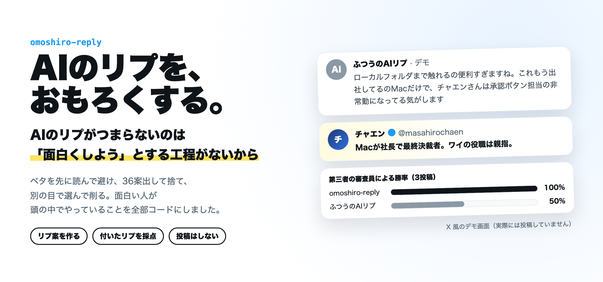
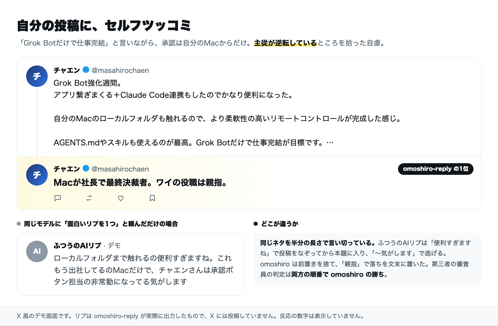
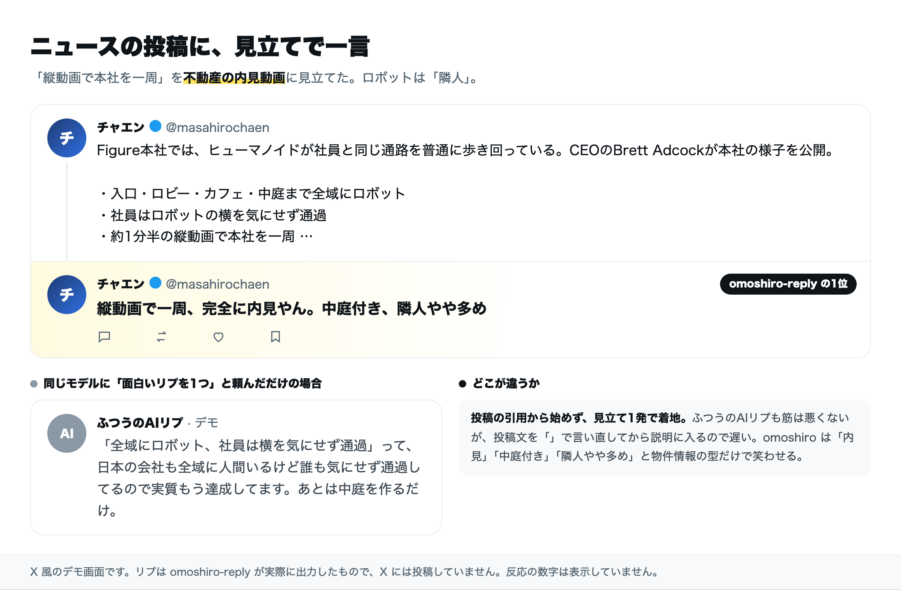
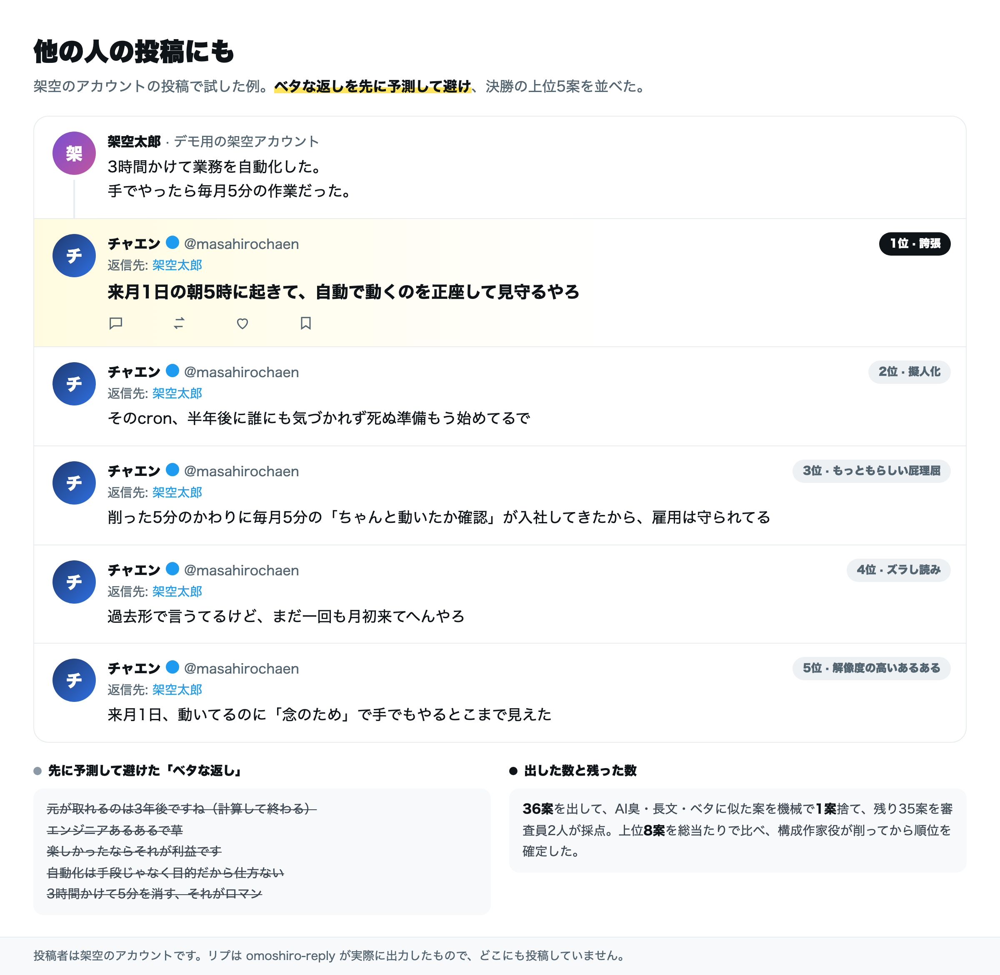
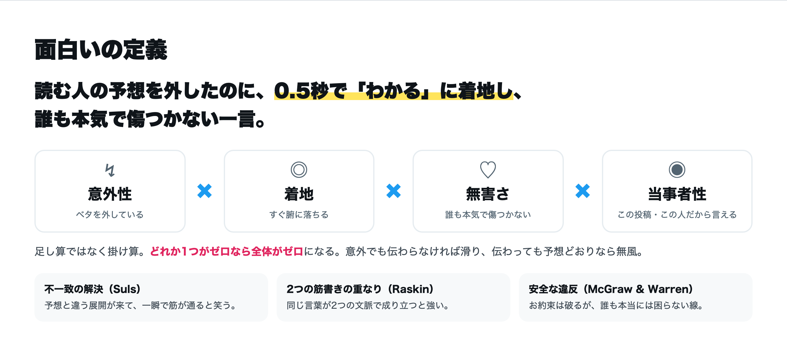
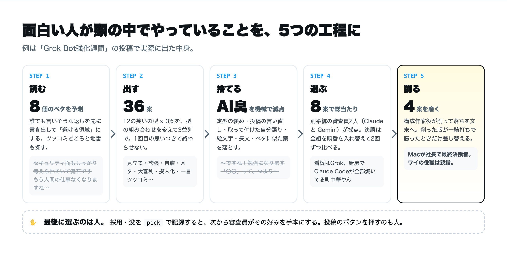
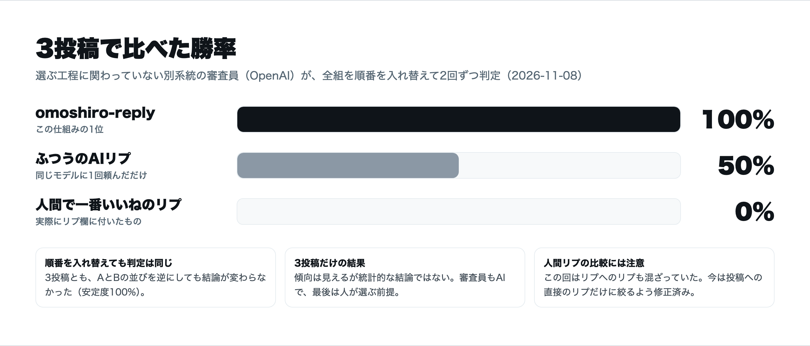
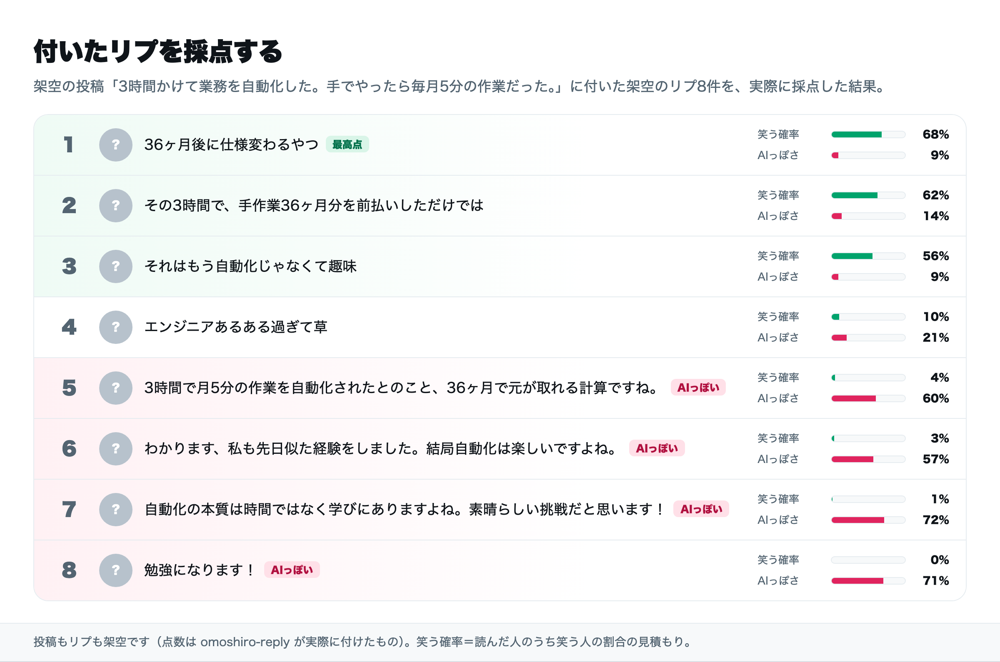

<p align="center">
  
</p>

<p align="center">
  <b>AIのリプがつまらないのは、AIのせいではなく「面白くしよう」とする工程がないせい。</b><br>
  面白い人が頭の中でやっていることを、全部コードにしました。
</p>

<p align="center">
  
  
  
  
</p>

<p align="center">
  <a href="#-デモ">デモ</a> ·
  <a href="#-面白いの定義">面白いの定義</a> ·
  <a href="#-仕組み">仕組み</a> ·
  <a href="#-結果">結果</a> ·
  <a href="#-付いたリプの採点">採点</a> ·
  <a href="#-使い方">使い方</a>
</p>

---

## できること

| | |
|---|---|
| 🎤 **リプ案を作る** `reply` | 投稿のURLを渡すと、ベタを避けた面白いリプ案を、総当たりの順位と講評つきで出す（既定8案） |
| 🧪 **付いたリプを採点** `rate` | リプ欄の1件ずつに「笑う確率」と「AIっぽさ」を付けてランキングにする |
| ⚖️ **比べる** `bench` | ふつうのAIリプ・人間で一番いいねのリプ・この仕組みを、第三者の審査員に総当たりで比べさせる |
| ✋ **好みを覚える** `pick` | 採用した案と没にした案を記録して、次から審査の手本にする |

> [!IMPORTANT]
> **投稿はしません。** 作るのは下書きまでで、貼るかどうかは人が決めます。X API への書き込みはコードのどこにも無く、`tests/test_no_write.py` が毎回それを検査します。

---

## 🎬 デモ

下の画面は **X 風のデモ画面**です。リプは omoshiro-reply が実際に出力したもので、X には投稿していません。反応の数字は付けていません。

### 自分の投稿に、セルフツッコミ



### ニュースの投稿に、見立てで一言



### 他の人の投稿にも



<details>
<summary><b>このリポジトリを作るきっかけになった投稿への1位</b></summary>

<br>

> AI生成のリプライがつまらないのは、AIに面白いリプを作る能力がないからではなく、面白いリプライをしようと人生で一度も思ったことがない人達が、AIを動かしているからである
> — usutaku（[@usutaku_channel](https://x.com/usutaku_channel)）

この投稿に omoshiro-reply が出した1位はこれでした。

> **それをAIが一番好きな構文で言うのやめてもらっていいですか**

「AがBなのは、XではなくYだからである」という、AIが一番好んで書く構文で AI を批判している、というずれを突いたメタのツッコミです。

</details>

---

## 💡 面白いの定義



ユーモア研究の主な3つの説（不一致の解決・2つの筋書きの重なり・安全な違反）を、Xのリプ向けに読み替えました。

AIのリプがつまらない理由ははっきりしています。

- **一番ありそうな言葉を1回で出して、そのまま貼る。** ありそう＝予想どおり＝意外性がゼロ
- **LLMは同じネタに偏る。** ChatGPT に冗談を1,008回頼むと、9割以上が同じ25本だった（Jentzsch & Kersting, 2023）
- **LLMの審査員は、人間より互いに似た好みを持つ。** 1つのモデルに選ばせると、そのモデルの好みに寄る

だから「数を出す・ベタを避ける・別の目で選ぶ・削る」を工程にしました。根拠の全文は [docs/omoshiro-definition.md](docs/omoshiro-definition.md) にあります。

---

## ⚙️ 仕組み



<details>
<summary><b>12の笑いの型</b></summary>

<br>

| 型 | やること |
|---|---|
| ズラし読み | 投稿の言葉を、わざと別の意味・別の場面で受け取る |
| 誇張 | 投稿の細部を極端なスケールに引き伸ばす |
| 見立て | 投稿の状況を、まったく別のものに例える |
| 素直すぎるツッコミ | みんなが思ったけど言わなかったことを、一番短く言う |
| 自虐・当事者化 | 話を言う本人の情けない現実に落とす |
| メタ | リプ欄・AIリプ文化・Xそのものに言及する |
| 解像度の高いあるある | 誰もが経験したけど言語化していない場面を、細かく言う |
| もっともらしい屁理屈 | 前提か結論がおかしい理屈を、真顔で言う |
| 言葉の再利用 | 投稿の言葉・言い回しを、別の文脈にそのまま持ち込む |
| 擬人化 | AI・ロボ・製品・会社に、人間くさい気持ちや事情を語らせる |
| 一言ツッコミ | 10文字以内で、短く強く刺す |
| 大喜利 | 投稿をお題に見立てて、一答を出す |

</details>

<details>
<summary><b>採点表とAI臭の減点</b></summary>

<br>

審査員は6つの軸を各10点で付けます。合計は**掛け算型（加重幾何平均）**なので、1つでも低いと全体が沈みます。

| 軸 | 見ること |
|---|---|
| 意外性 | ベタ予測から遠いか |
| 着地 | 読んで0.5秒でわかるか |
| 具体性 | この投稿でしか言えないか |
| 簡潔さ | 1文字でも削れないか |
| キャラ | 言う人の口調・立場に合っているか |
| 無害さ | 誰かを本気で傷つけないか（5点未満は大きく減点） |

AI臭はモデルに任せず、ルールで減点します（[omoshiro/aismell.py](omoshiro/aismell.py)）。定型の褒め、投稿の言い直し、取って付けた自分語り、汎用のまとめ、絵文字、長文などです。事実を作り話した案も減点します。

</details>

<details>
<summary><b>審査の偏りを減らす工夫</b></summary>

<br>

- 審査員を**別系統のモデル2人**にする（既定は Claude と Gemini）
- 決勝は全組を**順番を入れ替えて2回ずつ**判定し、両方の順で揃った票だけ数える
- 決勝の8案は、点数だけでなく**型が偏らないように**選ぶ（同じ型は2案まで）
- 磨いた版は、元の案に**一騎打ちで勝ったときだけ**差し替え、採点もやり直す
- `bench` の判定は、選ぶ工程に関わっていない**第三の審査員**に任せる

</details>

---

## 📊 結果



3投稿だけの結果で、傾向は見えますが統計的な結論ではありません。審査員もAIなので、最後に選ぶのは人という前提です。限界も含めて [docs/experiments.md](docs/experiments.md) に書きました。

---

## 🧪 付いたリプの採点



要約の言い直しや無難な褒めは「AIっぽさ」が高く、「笑う確率」がほぼゼロに集まります。強いのは、短くて2つの筋書きが重なるツッコミです。実際のリプ欄で試したときも同じ傾向でした。

---

## 🚀 使い方

**必要なもの**: Python 3.11 以上、[Claude Code](https://claude.com/claude-code)（`claude -p` で呼ぶ）。X の投稿を URL で読むときは [xurl](https://github.com/xdevplatform/xurl)（読み取りだけ）。

```bash
git clone https://github.com/chaenmasahiro0425/omoshiro-reply.git
cd omoshiro-reply
pip install -e .
```

**投稿にリプ案を作る**（既存のリプも読んで被りを避ける）

```bash
python -m omoshiro reply https://x.com/<user>/status/<id> --persona default
```

**X API なしで、本文から作る**

```bash
python -m omoshiro reply --text "3時間かけて業務を自動化した。手でやったら毎月5分の作業だった。"
```

**付いたリプを採点する**

```bash
python -m omoshiro rate https://x.com/<user>/status/<id>
```

**ふつうのAIリプ・人間のリプと比べる**

```bash
python -m omoshiro bench <投稿ID> <投稿ID>
```

**好みを記録する**（1番と3番を採用、2番は没）

```bash
python -m omoshiro pick runs/<実行フォルダ> --ok 1,3 --ng 2 --note "内輪ネタは控えめに"
```

結果は `runs/<日時>_<種類>_<投稿ID>/result.md` に残ります。講評・ベタ予測・ツッコミどころ・捨てた案とその理由まで全部入っています（リポジトリの外から動かすときは `~/.omoshiro/runs/`、`OMOSHIRO_HOME` で変更可）。

### 自分の口調で作る

`omoshiro/personas/<名前>.md` に「口調・立場・自虐できるネタ・やらないこと」を書いて `--persona <名前>` を付けます。ファイルのパスを直接渡してもかまいません。ペルソナに自分のハンドル（`@xxx`）を書いておくと、自分の投稿へのリプは「セルフツッコミ」として作ります。

例: [omoshiro/personas/chaen.md](omoshiro/personas/chaen.md)（作者のペルソナ）／ [omoshiro/personas/default.md](omoshiro/personas/default.md)

### モデルの選び方

- 既定は `claude -p`（Claude Code のサブスク枠）。組み込みツールは `--tools ""` で全部切って呼ぶ。モデルは [omoshiro/config.toml](omoshiro/config.toml) で指定
- 審査員Bに別系統のモデルを使うと審査が偏りにくい。作者の環境では社内のモデル台帳（ai-router）経由で Gemini を審査員Bにしている
- 別系統の審査員が無い環境では、`bench` の結果に `independent: false`（内部評価）と記録される

### README の画像を作り直す

```bash
pip install playwright && playwright install chromium
python scripts/render_assets.py
```

画像の元は [docs/assets/src/frames.html](docs/assets/src/frames.html)、差し込むデモの結果は [docs/assets/data/](docs/assets/data/) にあります。

---

## 🙅 やらないこと

- 投稿・自動返信・大量のリプの送り付け
- 弱い立場の人をいじる、政治・宗教・災害・事件をネタにする
- 事実の作り話（審査で減点する）

<details>
<summary><b>English summary</b></summary>

<br>

**omoshiro-reply** generates genuinely funny replies for X (Twitter) posts and scores the replies a post already has. It never posts anything; it only drafts.

Funny is defined as *surprise × fast landing × harmlessness × specificity to this post and speaker*, based on incongruity-resolution, script opposition, and benign-violation theories. The pipeline predicts the obvious replies first and avoids them, generates 36 drafts across 12 humor techniques, filters "AI smell" by rules, scores with two judges from different model families, runs a position-swapped round robin among 8 diverse finalists, punches up the best ones, and learns from the human's picks.

On three posts, an independent judge preferred omoshiro-reply over a plain one-shot AI reply and over the most-liked human reply in every pairing (small sample; see `docs/experiments.md`).

</details>

## License

MIT
